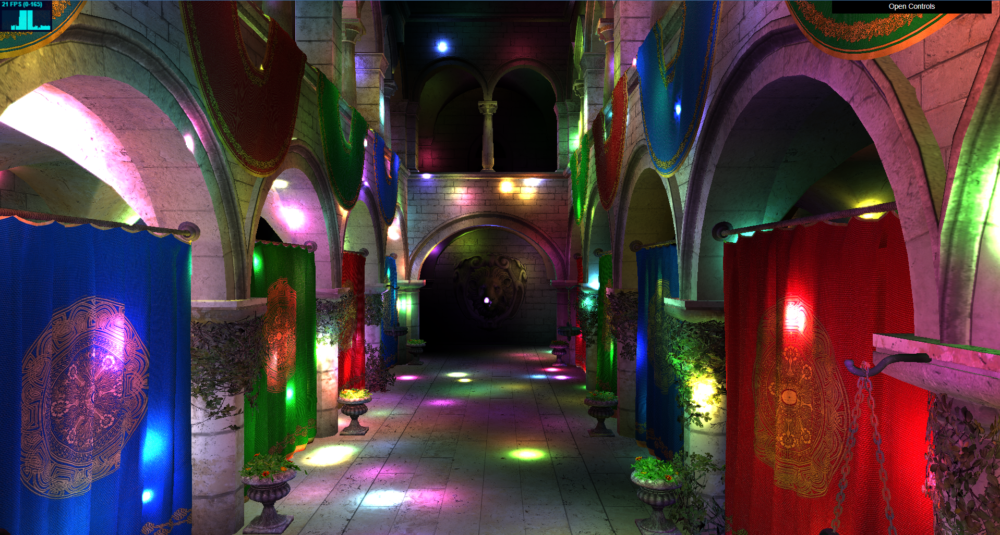
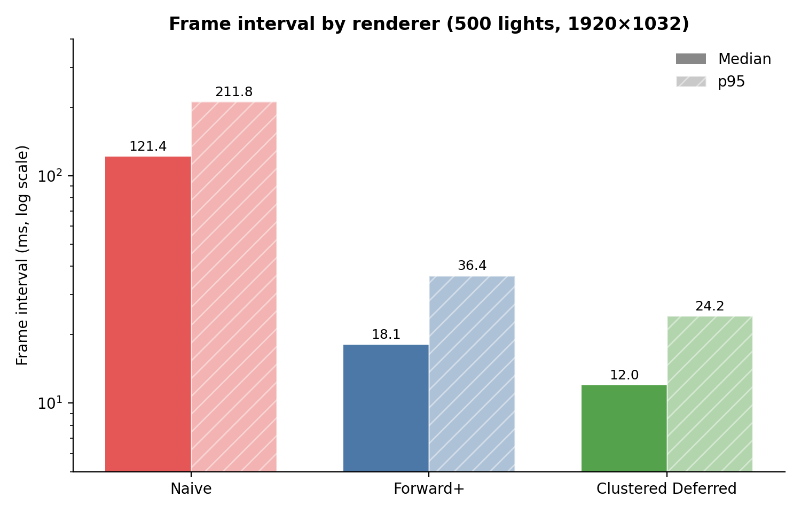
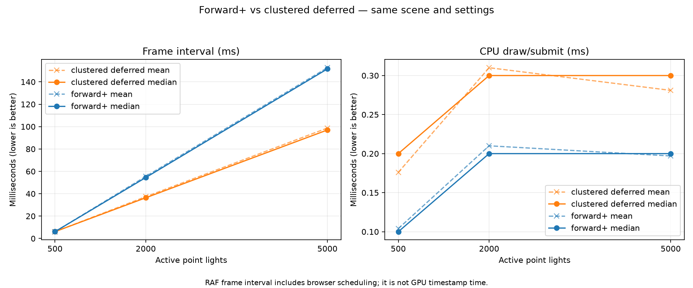
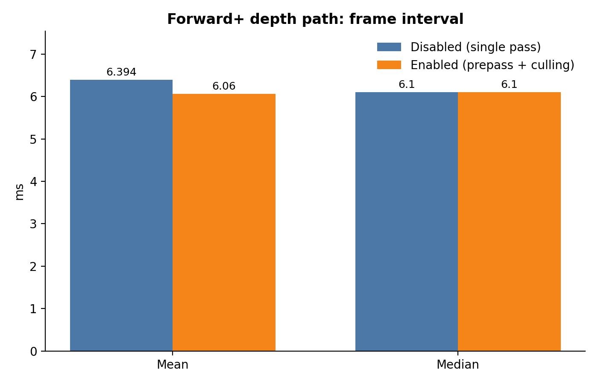
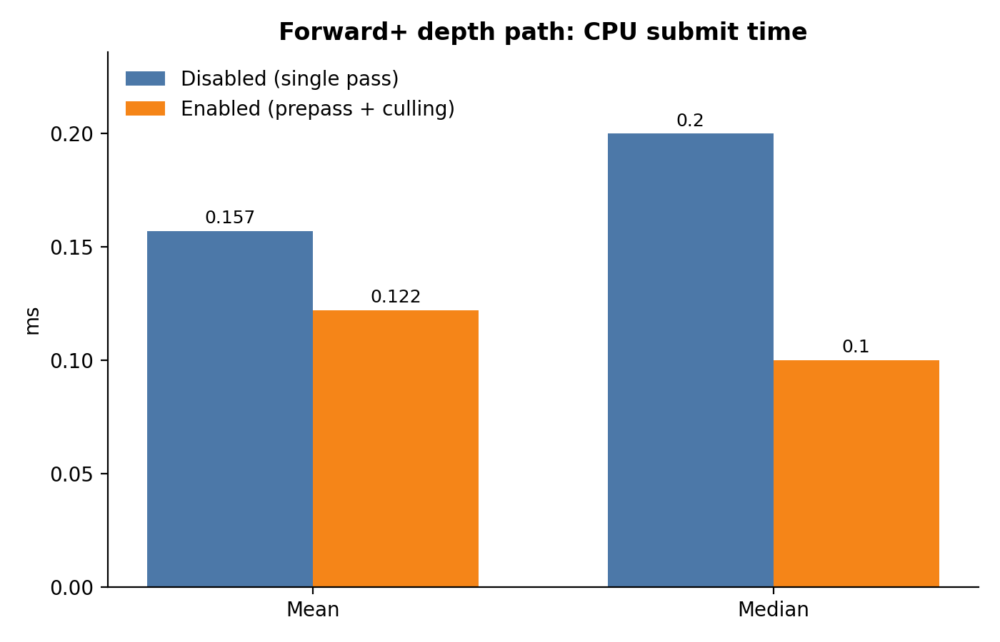
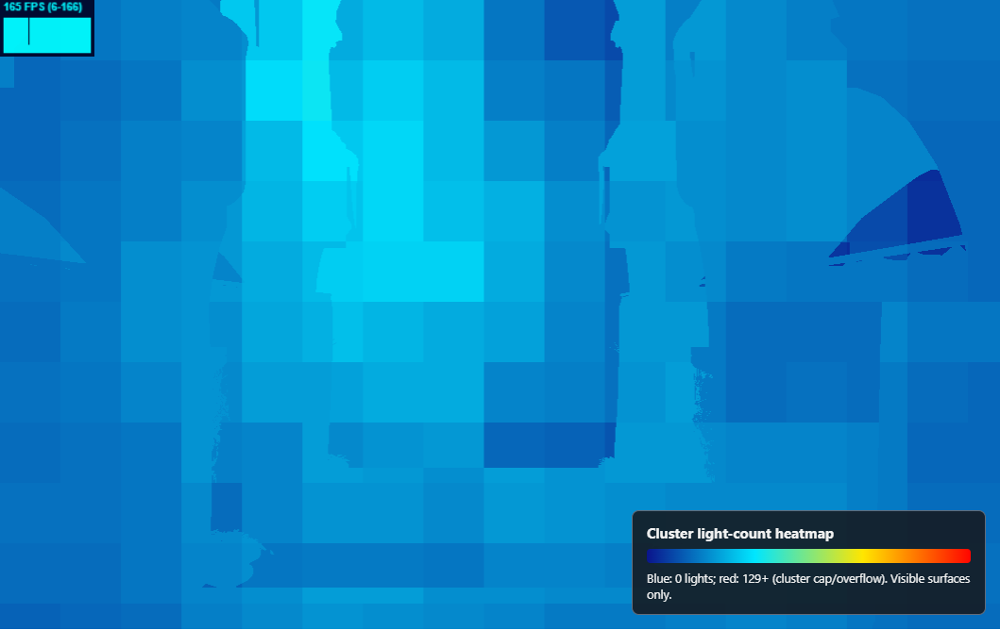
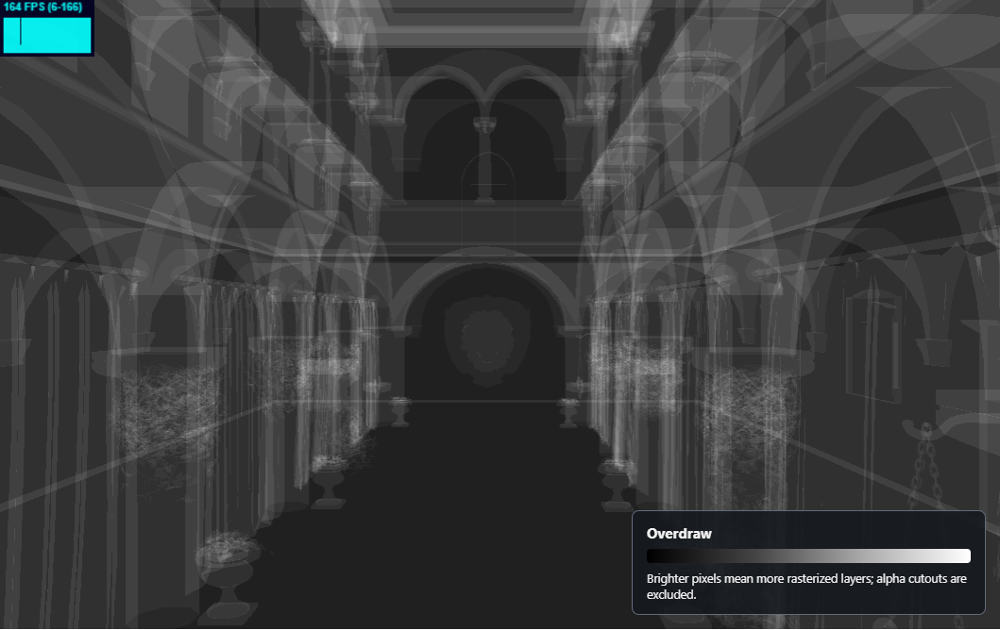

WebGL Forward+ and Clustered Deferred Shading
======================

**University of Pennsylvania, CIS 565: GPU Programming and Architecture, Project 4**

* Sau Lok Li
* Tested on: **Google Chrome 155.0.8059.80** on
  Windows 11, AMD Ryzen 9 270 w/ Radeon 780M Graphics, NVIDIA GeForce RTX 5070 Laptop GPU (8151 MiB), driver 596.13

### Live Demo

[](https://llok25.github.io/Project4-WebGPU-Forward-Plus-and-Clustered-Deferred/)
https://llok25.github.io/Project4-WebGPU-Forward-Plus-and-Clustered-Deferred/

### Demo Video/GIF

https://github.com/user-attachments/assets/0ea65a03-dcf8-42ba-897a-fa2212da1541

## Overview
 
This project renders the Sponza atrium lit by thousands of dynamic point lights using three techniques, switchable from the GUI:
 
* **Naive forward**: every fragment loops over every light.
* **Forward+**: lights are binned into a 3D grid of view-space clusters by a compute shader, and each fragment only evaluates the lights in its cluster.
* **Clustered Deferred**: reuses the same clustering, but writes a G-buffer first and does lighting in a separate fullscreen pass, so each pixel is shaded exactly once.
## Features implemented
**Base**
* Naive renderer: camera view-projection buffer, bind groups and shaders.
* Forward+ renderer: compute-shader light clustering with per-cluster light counts and index lists, and per-fragment lookup in the shading pass.
* Clustered Deferred renderer: G-buffer geometry pass plus a fullscreen lighting pass reusing the Forward+ clustering.

**Extra credit**
* **Depth prepass for Forward+**: depth-only prepass, reused so the lighting pass shades only visible fragments (overdraw-free shading).
* **Depth-based cluster culling**: a pass after the prepass that marks clusters containing visible geometry, which the clustering step then uses.
* **Render bundles**: static draw calls recorded once and replayed, toggleable from the GUI.

**Tooling**
* In-app benchmark that exports per-frame frame-interval, CPU submit time, and per-pass GPU times to CSV. All numbers below come from this.


## Performance analysis

### Naive vs Forward+ vs Clustered Deferred

## Results (frame interval, ms)
 
| Renderer | Mean | Median | p95 | Max | FPS (from median) |
|---|---:|---:|---:|---:|---:|
| Naive | 176.4 | 121.4 | 211.8 | 13,399.5 | 8.2 |
| Naive (excluding one outlier) | 132.2 | 121.4 | 207.0 | n/a | 8.2 |
| Forward+ | 17.6 | 18.1 | 36.4 | 60.7 | 55.3 |
| Clustered Deferred | 11.5 | 12.0 | 24.2 | 30.4 | 83.3 |


 
## Analysis
 
- **Naive is about 7× slower than Forward+ and 10× slower than Clustered Deferred** by median (121 vs 18 vs 12 ms). Even 500 lights is far too many for a loop over every light per fragment at this resolution. Its CPU submit time (0.18 ms) is no higher than the others', so the cost is entirely the GPU-side shader loop. The view-projection buffer and bind groups are not the bottleneck.
- **One Naive sample is a 13.4-second stall** (sample 191), and it is what drags the mean to 176 ms. It is probably a tab hitch or GPU timeout rather than a renderer property, so I'd report the median or the trimmed mean (132 ms) and mention the exclusion.
- **Clustering pays off at this resolution.** At 500 lights Forward+ was vsync-bound on the earlier 1058×782 run. At 1920×1032, about 2.5× the pixels, it no longer is, so you can finally see a real gap between the two clustered renderers.
- **Clustered Deferred is about 33% faster than Forward+** (12.0 vs 18.1 ms median). That matches the 33–35% gap in the 2,000- and 5,000-light runs, which suggests the deferred advantage holds across light counts and resolutions. It also has tighter spread (p95 24 vs 36 ms).
- **Forward+ drifts slower during the run.** The first 50 samples average 13.9 ms and the last 50 average 16.2 ms, which could be thermal throttling or the sampling window catching vsync quantization differently. Clustered Deferred and Naive stay flat. Worth repeating the Forward+ run to see whether it reproduces.
 

### Forward+ vs clustered deferred

I compared the current implementations at 500, 2,000, and 5,000 moving point
lights with the same Sponza view, 1058x567 canvas, 3-second warm-up, and 200
samples per renderer. Render bundles were enabled for both. Forward+ depth
prepass and depth-based cluster culling were enabled for Forward+. Clustered
deferred includes compact G-buffer compute shading and bloom. The browser was
Chrome 150 embedded in VS Code/Electron 43.7.7. The adapter for this original
batch was not recorded; its results are environment-specific and superseded
where the new timestamped light sweep below overlaps.

| Lights | Renderer | Frame interval mean (ms) | Frame interval median (ms) | CPU draw/submit mean (ms) | CPU draw/submit median (ms) |
| ---: | --- | ---: | ---: | ---: | ---: |
| 500 | Forward+ | 6.060 | 6.100 | 0.104 | 0.100 |
| 500 | Clustered deferred | 6.060 | 6.100 | 0.176 | 0.200 |
| 2,000 | Forward+ | 55.515 | 54.500 | 0.210 | 0.200 |
| 2,000 | Clustered deferred | 37.363 | 36.400 | 0.310 | 0.300 |
| 5,000 | Forward+ | 152.660 | 151.600 | 0.197 | 0.200 |
| 5,000 | Clustered deferred | 98.753 | 97.000 | 0.281 | 0.300 |



The plotted frame interval is the time between animation frames, not a GPU
timestamp. At 500 lights both renderers sit at about 6.1 ms, likely the
foreground frame-scheduling/display floor; the measurement does not establish a
GPU speed difference there. At 2,000 and 5,000 lights, clustered deferred's
median frame interval was respectively 33.2% and 36.0% lower than Forward+'s in
this run. This suggests clustered deferred handled this high-light workload
better in this scene. It should not be generalized to all hardware or scenes:
frame intervals include browser scheduling and queue behavior, and the two
renderers do different extra work (Forward+ prepass/culling vs deferred
G-buffer/compute/bloom).

The archived 200-sample summaries were generated before the benchmark's
even-sample median calculation was corrected to average the two middle
observations. The displayed historical medians use the upper middle sample and
can differ from a conventional median by up to one sample step; new benchmark
runs use the conventional even-sample median. The original per-frame samples
for these aggregated results were not retained.

The CPU draw/submit duration shows the tradeoff in host-side work: Forward+
recorded about 0.1-0.2 ms per frame, while clustered deferred recorded
0.2-0.3 ms. Deferred has separate geometry, lighting, and bloom passes; its
extra JavaScript command setup does not translate directly to more elapsed
frame time at high light counts. Render bundles reduce repeated scene draw
encoding in both paths, but do not remove compute or pixel shading work.

Forward+ is attractive for low/moderate light counts, limited render-target
bandwidth, or scenes with less overdraw. It shades geometry directly and does
not write/read a G-buffer. Its fragment lighting cost follows visible shaded
fragments and can rise with overdraw; the optional depth optimization adds a
geometry pass and a per-pixel cluster mask pass. Clustered deferred pays for
G-buffer writes/reads and world-position reconstruction, but shades only the
visible surface and separates geometry from lighting. It can win when
overdraw or light-count shading cost dominates; its extra passes and memory
traffic can be a loss when the scene is simple or bandwidth-limited. This
implementation additionally runs bloom, so this comparison is of the complete
current renderers rather than a pure apples-to-apples shading kernel test.

The renderer shaders index the light array one light at a time; they do not
copy the full light array or a large per-cluster array into a local variable.
No WGSL pointer rewrite was needed. A more definitive GPU comparison would use
timestamp queries (where supported) and vary overdraw, resolution, and light
count independently.

### Optimization/effect measurements and tradeoffs

The G-buffer change reduces color storage from 20 B/pixel (two `rgba16float`
images plus one `rgba8unorm` image) to 8 B/pixel in one `rg32uint` image, a
60% reduction in that part of the G-buffer. It also replaces the fullscreen
rendering pass with compute shading and reconstructs world position from
depth. The current benchmark compares the complete renderer, not the old and
new G-buffer implementations in isolation; no before/after timing claim is
made for this change.

Bloom adds a half-resolution bright extraction and blur/composite compute
dispatch. It costs additional dispatch and texture bandwidth and can be most
noticeable at high resolutions; the half-resolution bright texture limits
that cost. No bloom-off comparison was captured, so the specific effect cost
is not quantified yet.

For Forward+ depth prepass plus depth-based culling, the 500-light test used
200 samples after a 2-second warm-up with the same 1058x567 canvas and render
bundles enabled:

| Forward+ path | Frame interval mean (ms) | Frame interval median (ms) | CPU draw/submit mean (ms) | CPU draw/submit median (ms) |
| --- | ---: | ---: | ---: | ---: |
| Single pass, no depth culling | 6.394 | 6.100 | 0.157 | 0.200 |
| Depth prepass + cluster mask | 6.060 | 6.100 | 0.122 | 0.100 |

This run shows no median frame-interval change at 500 lights. The mask pass
marks clusters touched by visible pixels; clustering skips inactive clusters
but retains the same dispatch count (no stream compaction). It should help most
when many clusters are empty and/or overdraw is high, and less when most
clusters are active or light counts are low. At higher light counts it avoids
cluster/light tests for inactive clusters and the depth-equal final pass avoids
shading occluded fragments. The extra prepass, fullscreen mask, atomics, and
mask clear can outweigh these savings in sparse/low-light cases. The light
scaling comparison above uses this optimized Forward+ path.

Render bundles target CPU draw-call overhead only. A 10-sample, zero-warm-up
smoke comparison at 500 lights showed the following CPU draw/submit medians
(off to on); the sample is too small and noisy for a performance conclusion:

| Renderer | Bundles off (ms) | Bundles on (ms) | Frame interval median off → on (ms) |
| --- | ---: | ---: | ---: |
| Forward+ | 0.200 | 0.100 | 9.100 → 21.100 |
| Clustered deferred | 0.250 | 0.150 | 6.100 → 6.100 |

The CPU trend is consistent with reducing host command encoding, but the frame
interval variation demonstrates why a warmed-up, repeated run is needed. The
best case is many stable draw calls with a CPU-bound renderer; the worst is a
small or GPU-bound scene. Bundles do not reduce GPU shading work and need
re-recording if bound geometry/material resources change.

The aggregated light-scaling data and plotting script are available at
[renderer-comparison.csv](./results/renderer-comparison.csv) and
[plot_renderer_comparison.py](./scripts/plot_renderer_comparison.py). To
recreate the graph:

```powershell
py -3.12 scripts\plot_renderer_comparison.py results\renderer-comparison.csv --output results\renderer-comparison.png
```

### Part 2: Clustered Deferred G-buffer Optimization

The clustered deferred renderer packs an octahedrally encoded world normal and
8-bit RGB albedo into two `u32` channels in a single `rg32uint` G-buffer image.
The lighting compute shader reads that image and the depth attachment, rebuilds
world position with the inverse view-projection matrix, and writes the lit
result directly to the canvas. This replaces the three color G-buffer images
and fullscreen vertex/fragment lighting pass.

The G-buffer color storage is 8 bytes per pixel instead of 20 bytes per pixel
(two `rgba16float` images plus one `rgba8unorm` image), a 60% reduction. This
does not include the unchanged depth attachment.

#### Compute bloom post-processing

The clustered deferred path keeps its lighting result in an HDR `rgba16float`
texture, then runs two compute passes for bloom. The first downsamples to half
resolution and extracts pixels above a luminance threshold. The second applies
a 3x3 Gaussian-weighted blur to that bright image and adds the result to the
full-resolution scene before writing to the canvas. Bloom uses a fixed
0.65 luminance threshold and 1.5 composite strength.

The reduced-resolution bright texture keeps the blur taps and bandwidth lower
than a full-resolution blur. Bloom adds two compute dispatches and intermediate
texture traffic, so it may cost performance in scenes with few bright pixels;
the benefit is a soft glow around bright lighting. The in-app benchmark's
clustered-deferred results include the bloom passes. Its isolated timing has
not yet been captured; see the performance analysis above.

#### Render bundles

Forward+ geometry and the clustered-deferred G-buffer pass each record their
static scene draw commands once into a `GPURenderBundle`. Each frame replays
that bundle in its render pass instead of having JavaScript reissue the
per-node, per-material, and per-primitive commands. The camera, light, and
cluster buffers are updated in place, so their bind groups remain valid while
the bundle is reused. A GUI checkbox switches bundle execution off to provide a
same-build comparison; naive rendering does not use bundles.

Bundles primarily reduce CPU command-encoding and API-call overhead. They do
not reduce geometry, pixel, or lighting work on the GPU. The best case is a
scene with many draw calls and stable geometry/material bindings, where host
submission is a bottleneck. The worst case is a small or GPU-bound scene, where
the saved CPU work is negligible; bundle recording also costs setup time and
the scene must be re-recorded if its draw structure or bound resources change.

To measure the effect, leave the scene, light count, resolution, browser, and
build label unchanged. Select **Forward+ vs clustered deferred** in the
benchmark's renderer-set control, run once with render bundles enabled and
again with them disabled, and download each CSV. Rows contain a
`render_bundles` column, and the plot script groups enabled and disabled
results separately. Compare median CPU draw/submit duration and frame
interval; do not interpret either as GPU-only execution time. A 10-sample
pilot is summarized in the performance analysis above; repeat with the
recommended warm-up/sample settings on the target system.

#### Forward+ depth prepass and cluster culling

Forward+ first renders alpha-tested geometry to a depth-only attachment. Its
lighting pass then loads that depth and uses an `equal` depth test with depth
writes disabled, so occluded fragments are rejected before the expensive
Forward+ fragment shader. Alpha testing is retained in the depth pass so cutout
materials do not incorrectly occlude geometry behind them.

Between the prepass and light clustering, a fullscreen-triangle pass reads
depth. Each covered pixel reconstructs view depth, derives its tile and
logarithmic depth slice, and atomically marks that cluster active. The cluster
compute shader checks the mask before calculating bounds or testing lights.
This is direct mask-based skipping: dispatch count remains unchanged, and there
is no stream compaction. Other renderers use a separate all-active mask.

Depth culling is most useful when many tile/depth clusters are empty and the
scene has substantial overdraw. The compute shader then avoids scanning lights
for those clusters, and the final shading pass shades only the visible depth
surface. It can be less useful when most clusters contain geometry or light
counts are small, since the extra depth draw, fullscreen mask atomics, and
buffer clear have a cost. The active set is conservative only to the pixel
coverage recorded by the depth prepass, with one cluster marked for each
visible pixel.

Use the **Forward+ depth optimizations** GUI checkbox to compare the original
single-pass Forward+ path with prepass plus depth-based culling in the same
build. Run the benchmark under both settings, then plot the CSV exports
together. The `forward_plus_depth` column distinguishes settings. Evaluate
more than one light count and scene/camera view: the optimization adds
fixed per-pixel and per-geometry work while saving light tests in inactive
clusters. Initial measurements from this workspace session follow.

Initial same-session measurements (200 samples per renderer after a 2-second
warm-up, 500 lights, 1058x567 canvas, render bundles enabled, Chrome 150 inside
VS Code/Electron) are below. Frame interval is wall-clock time between frames,
and CPU submit is command encoding plus submission; neither is GPU-only time.
The medians are unchanged at 6.10 ms, so this run does not show a measurable
frame-interval improvement. CPU submit was lower in this run, but sub-millisecond
measurements in a shared browser session are susceptible to noise and should
be rechecked on the target system.

| Forward+ depth path | Frame interval mean (ms) | Frame interval median (ms) | CPU submit mean (ms) | CPU submit median (ms) |
| --- | ---: | ---: | ---: | ---: |
| Disabled (single pass) | 6.394 | 6.100 | 0.157 | 0.200 |
| Enabled (prepass + culling) | 6.060 | 6.100 | 0.122 | 0.100 |





### Debug views
 
#### Cluster light-count heatmap
 

 
- Each screen-space cluster is colored by how many lights overlap it: blue is 0 lights and red is 129+ (the cluster cap, where lists overflow). Only visible surfaces are shown.
- Every cluster here is blue to cyan. Judging by position on the legend, that is roughly 15–40 lights per cluster, and nothing approaches yellow or red, so **no cluster comes near the cap and no light lists are being truncated.**
- **How it correlates with performance:** the cost of the lighting pass is the sum over pixels of the lights in that pixel's cluster, so the brighter cyan central columns are where most lighting time is spent. Cost per light rises as lists fill up and then flattens (section 1). More lights shifts the whole image toward green, then yellow.
- The same view also shows why depth-based cluster culling gained nothing: the visible surfaces cover essentially every cluster column, leaving few empty clusters to skip.
#### Overdraw
 

 
- Brighter pixels mean more rasterized layers, excluding alpha cutouts. The floor is darkest, while the arcades, columns, and curtains where geometry overlaps along the view direction are brightest.
- **How it correlates with performance:** with no prepass, each layer pays for the full light loop, so Forward+'s shading cost scales with this image's brightness. Most of the frame is mid-gray or brighter rather than black, which fits the measured 3.2–3.5× drop in shading time when the prepass collapses it to one layer per pixel.
- Deferred is unaffected by overdraw, since the lighting pass runs once per pixel, which is why it needs no prepass.

#### Automated benchmark

The in-app **Renderer benchmark** runs the naive, Forward+, and clustered
deferred renderers in sequence. It discards the configured warm-up period,
collects the requested number of frame samples per renderer, and exports a CSV.
Each row includes the build label, renderer, light count, canvas resolution,
browser user agent, experiment name, render-bundle and Forward+ depth
optimization states, frame interval, CPU draw/submit duration, adapter
metadata, timestamp-query support, and available per-pass GPU timestamps. The
default is a 3-second warm-up and 200 samples per configuration.

Choose an **Experiment** preset to run the seven-point light sweep, Forward+
depth on/off at 2,000 and 5,000 lights, or render-bundle on/off for both
renderers at 2,000 lights. Each CSV row includes the active configuration.

Use the **×** control on the benchmark panel to clear it from screenshots and
recordings. Press **B** while the page is not focused on a text or select field
to show or hide the panel again.

Frame interval is measured between animation frames and includes browser
scheduling/vsync. CPU draw/submit measures JavaScript command encoding and
submission; it does **not** measure asynchronous GPU execution. When the
adapter supports `timestamp-query`, the CSV also records per-pass GPU timings
for clustering, Forward+ depth/mask/shading, deferred G-buffer/lighting, and
bloom. These are per-pass durations, not total frame GPU time. The tool
reports milliseconds, not FPS.

For comparable runs, keep the browser/GPU, canvas size, camera position, light
count, and power mode constant; avoid interacting with the page and keep it
foregrounded. Enter a distinct build label for each revision (for example,
`baseline` and `compact-compute`) and download each CSV.

Install the plotting dependency and plot one or more exported CSVs:

```powershell
python -m pip install matplotlib
python scripts/plot_benchmark.py baseline.csv compact-compute.csv --output benchmark-results.png
```

The script prints sample count, mean, median, and 95th percentile in
milliseconds, and plots median plus interquartile range for both frame interval
and CPU draw/submit duration. It groups data by experiment, build label,
renderer, light count, bundle state, and Forward+ depth optimization state.
To recreate the dedicated sweep charts:

```powershell
python scripts/plot_benchmark_sweeps.py --light-sweep result\renderer-light-sweep.csv --depth-csv result\renderer-depth-comparison.csv --bundles-csv result\renderer-bundles-comparison.csv --output-dir result
```

### Credits

- [Vite](https://vitejs.dev/)
- [loaders.gl](https://loaders.gl/)
- [dat.GUI](https://github.com/dataarts/dat.gui)
- [stats.js](https://github.com/mrdoob/stats.js)
- [wgpu-matrix](https://github.com/greggman/wgpu-matrix)
